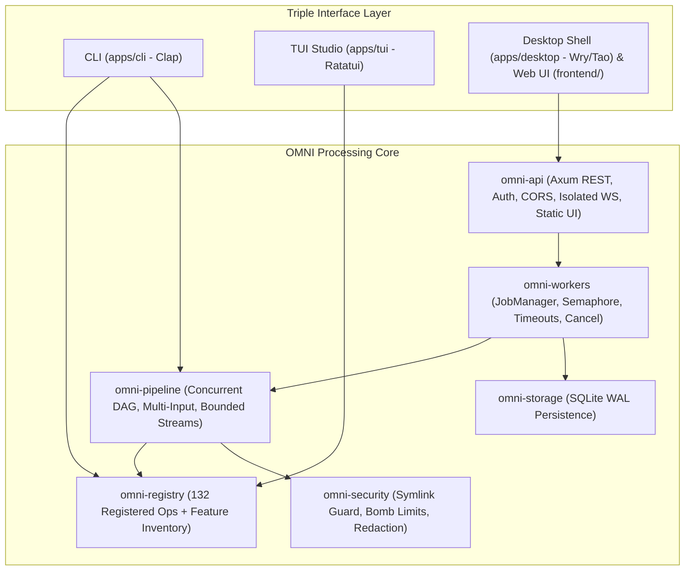

# OMNI — The Universal Digital Engineering Toolkit

[](https://github.com/rajveersinh-is-dev/omni-toolkit/actions/workflows/ci.yml)
[](LICENSE)
[](https://www.rust-lang.org)

**OMNI** is a local-first, Rust-powered developer, security, and digital forensics engineering platform with a typed concurrent DAG pipeline engine, an Axum REST/WebSocket backend, and three interfaces (CLI, TUI, and Desktop/Web GUI).

---

## Core Architectural Pillars

1. **Unified Processing & Concurrent DAG Pipeline Engine (`omni-core`, `omni-pipeline`)**:
   - Strongly typed `DataPayload` contract (`Text`, `Bytes`, `Json`, `FileRef`, `Multi`).
   - Dependency-aware concurrent DAG scheduler (`JoinSet` + bounded `Semaphore` concurrency) with deterministic multi-parent input assembly (`BTreeMap` keyed by port or parent ID), static edge type-compatibility checking, cycle/duplicate-edge rejection, and immediate cancellation propagation.
   - Bounded async chunk streaming (`spawn_chunk_producer`, `spawn_stream_stage`) with explicit backpressure.
   - Per-node execution observability (`PipelineExecutionReport`: execution ID, timestamps, durations, output sizes, and statuses).

2. **Hardened Local-First Backend (`omni-api`, `omni-workers`, `omni-storage`, `omni-security`)**:
   - **API Security**: Strict configurable CORS allowlist (defaults to loopback origins), optional Bearer/`X-Omni-Token` authentication (enforced when binding to non-loopback addresses), 16 MB request body limit, bounded timeouts, and sanitized error responses.
   - **WebSocket Isolation**: Supports per-job subscriptions (`/api/v1/ws/jobs?job_id=<id>`), token validation, connection limits, and lag handling.
   - **Worker Lifecycle**: Explicit `JobStatus` state transitions (`queued` -> `running` -> `completed` | `failed` | `cancelled` | `timed_out`), immediate cancellation + task abort on timeout, panic isolation, SQLite WAL persistence, and startup recovery of interrupted jobs.
   - **Filesystem & Resource Safety**: Canonical symlink-escape prevention (`safe_join`, `safe_join_no_symlinks`), atomic `create_new` writes, overflow-safe decompression bomb limits (100x / 500 MB), and secret/path redaction.

3. **Three Interfaces (`apps/cli`, `apps/tui`, `apps/desktop`, `frontend/`)**:
   - **CLI (`omni`)**: UNIX stdin/stdout filter workflows, category/status/tag filtering, machine-readable JSON & inventory export, and pipeline validation/execution.
   - **TUI (`omni-tui`)**: Keyboard-driven Ratatui terminal studio with interactive input editing, category browsing, and fuzzy search.
   - **Desktop & Local Web UI (`omni-desktop` + `frontend/`)**: Local-first HTML/JS frontend served directly by the Axum backend (zero external CDN/font requests), with optional native OS window via `--features native-webview` (`tao` + `wry`) bound to an ephemeral loopback port with a per-launch session token and strict origin navigation lock.

---

## Architecture Overview



---

## Registered Operations & Honest Feature Status

OMNI currently registers **132 operations** across 10 engineering categories. The exact, machine-generated status inventory is maintained in [docs/feature-inventory.json](docs/feature-inventory.json) and [TRACEABILITY_MATRIX.md](TRACEABILITY_MATRIX.md):

| Status | Count | Meaning |
|---|---:|---|
| `verified` | 17 | Verified against dedicated unit, security, or end-to-end tests |
| `implemented` | 112 | Working implementation compiled and registered across interfaces |
| `experimental` | 2 | Requires optional host binaries (`media.transcode` -> `ffmpeg`; `pdf.ocr` OCR mode -> `tesseract`) |
| `unsupported` | 1 | Explicitly unsupported (`crypto.pqc.falcon` — returns clear error; use FIPS 203/204/205 ops instead) |
| **Total** | **132** | Generated directly via `omni --json inventory` |

### Highlights of Verified Capabilities
- **Post-Quantum Cryptography (Pure Rust)**: Real NIST FIPS 203 (`crypto.pqc.ml_kem`: ML-KEM-768 keygen/encapsulate/decapsulate), FIPS 204 (`crypto.pqc.ml_dsa`: ML-DSA-65 keygen/sign/verify), and FIPS 205 (`crypto.pqc.sphincs_plus`: SLH-DSA-SHA2-128f keygen/sign/verify).
- **Binary & Disassembly**: Full x86-16/32/64 instruction decoding and Mermaid/JSON CFG generation via `iced-x86`, plus ELF/PE/Mach-O/WASM checksec inspection via `goblin`.
- **AI & Tokenization**: Authentic BPE tokenization (`cl100k_base`, `o200k_base`, `p50k_base`, `r50k_base`) via `tiktoken-rs`, GGUF/Safetensors header inspection, vector metrics, and quantization precision metrics.
- **Documents & Diagrams**: Real offline Mermaid flowchart & Graphviz DOT SVG compiler, recursive LaTeX-subset math parser (MathML & SVG), Markdown transpiler, and PDF internals/metadata scrubber.
- **Networking, PCAP & Forensics**: RFC 1035 DNS wire encoder/decoder (with pointer-cycle guard & scoped resolver), quote-aware cURL-to-Rust/Python/Go/Node codegen, PCAP/PCAPNG dissector & TCP stream reassembler, read-only SQLite CSV/JSON analytics, and bomb-guarded ZIP/TAR/GZIP inspection.

---

## Prerequisites & Build

- **Rust toolchain**: 1.80+ (`rustup`)
- **Optional external tools**:
  - `ffmpeg` on `PATH` (for `media.transcode` execution mode; `mode="plan"` works offline without FFmpeg).
  - `tesseract` on `PATH` (for `pdf.ocr` optical recognition on raster images; embedded PDF text extraction works offline via `lopdf`).
  - On Linux, building `omni-desktop --features native-webview` requires GTK3/WebKit2GTK development headers.

```bash
# Clone
git clone https://github.com/rajveersinh-is-dev/omni-toolkit.git
cd omni-toolkit

# Run full workspace tests (all 30 crates)
cargo test --workspace

# Verify zero Clippy warnings
cargo clippy --workspace --all-targets -- -D warnings
```

---

## Quickstart Examples (Verified)

### 1. CLI Operations & Filtering
```bash
# List all registered operations
cargo run -p omni -- list

# Filter by category and keyword
cargo run -p omni -- list --category Encoders --query base64

# Export machine-readable feature inventory
cargo run -p omni -- --json inventory

# Base64 encode from stdin
echo -n "hello omni" | cargo run -p omni -- encode base64

# Run real FIPS 203 ML-KEM-768 keygen + encapsulation + decapsulation roundtrip
cargo run -p omni -- run crypto.pqc.ml_kem --config '{"action":"roundtrip"}'

# Validate and execute a DAG pipeline with full JSON execution report
cargo run -p omni -- pipeline validate docs/pipeline-examples/hash_and_hex.json
cargo run -p omni -- --json pipeline run docs/pipeline-examples/hash_and_hex.json tests/fixtures/sample.json
```

### 2. Local Web API & Browser Studio
```bash
# Loopback local mode (serves frontend/ at http://127.0.0.1:8080/)
cargo run -p omni -- serve --host 127.0.0.1 --port 8080

# Non-loopback exposure requires explicit bearer token authentication
cargo run -p omni -- serve --host 0.0.0.0 --port 8080 --auth-token "your-strong-secret"
```

### 3. Desktop Application
```bash
# Headless local web UI server mode (cross-platform default)
cargo run -p omni-desktop

# Native OS window via Wry + Tao (ephemeral loopback port + per-launch session token)
cargo run -p omni-desktop --features native-webview
```

### 4. Interactive TUI Studio
```bash
cargo run -p omni-tui
```

---

## Benchmarks

Run the reproducible in-process benchmark suite (`std::time::Instant`, 5 discarded warmup runs, 20 measured iterations over deterministic 1 MB Xorshift payloads):

```bash
cargo run --release -p omni-benchmarks
```

Sample measurement on Windows x86_64 (release profile, Rust stable):

| Operation | Dataset | Warmup / Iters | Mean Latency | Throughput |
|---|---|---|---:|---:|
| `crypto.hash.sha256` | 1 MB | 5 / 20 | 947.2 μs | 1055.77 MB/s |
| `crypto.hash.blake3` | 1 MB | 5 / 20 | 378.1 μs | 2644.63 MB/s |
| `encode.base64` | 1 MB | 5 / 20 | 895.9 μs | 1116.18 MB/s |
| `checksum.crc32` | 1 MB | 5 / 20 | 263.5 μs | 3794.56 MB/s |

---

## Known Limitations

- **Native External Tool Dependencies**: `media.transcode` (execution mode) and `pdf.ocr` (optical OCR) delegate to host `ffmpeg` and `tesseract` executables when present on `PATH`; they return explicit errors rather than synthetic output if unavailable.
- **Disassembly Scope**: `binary.disasm` supports x86-16, x86-32, and x86-64 via `iced-x86`; ARM/AArch64/RISC-V/MIPS are not yet implemented.
- **SQL Analytics Engine**: `storage.sql` runs in-memory SQLite over CSV, TSV, and JSON arrays (read-only `SELECT`/`WITH`/`EXPLAIN`); DuckDB and Parquet ingestion are not bundled.
- **Post-Quantum Falcon**: `crypto.pqc.falcon` is marked `unsupported` until an audited pure-Rust NIST-finalized FN-DSA crate is integrated.
- **Process Sandboxing**: Worker isolation uses Tokio tasks, semaphores, timeouts, and panic boundaries; OS-level kernel sandboxing (seccomp/AppContainer) is not currently enforced.

---

## Security & Documentation

- Security architecture & threat model: [SECURITY.md](SECURITY.md) & [docs/security/threat-model.md](docs/security/threat-model.md)
- Complete feature traceability: [TRACEABILITY_MATRIX.md](TRACEABILITY_MATRIX.md)
- Tutorials & examples: [docs/tutorials/getting-started.md](docs/tutorials/getting-started.md), [docs/tutorials/pipeline-composition.md](docs/tutorials/pipeline-composition.md), [examples/README.md](examples/README.md)

## License

Dual-licensed under Apache-2.0 or MIT at your option ([LICENSE](LICENSE)).
