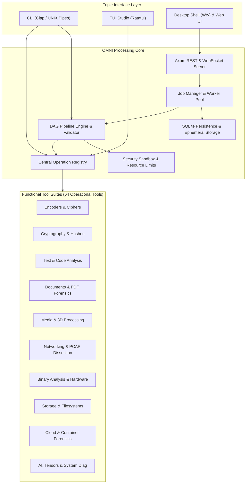

# OMNI — The Universal Digital Engineering Toolkit

[](https://github.com/rajveersinh-is-dev/omni-toolkit/actions/workflows/ci.yml)
[](LICENSE)
[](https://www.rust-lang.org)

**OMNI** is a high-performance, local-first engineering multitool for developers, systems engineers, security researchers, and digital forensics practitioners. It combines the practical capabilities of tools like CyberChef, Wireshark, FFmpeg, jq, Pandoc, Binwalk, Capstone, and DuckDB into a unified, typed, composable engineering platform.

---

## Key Highlights

- **Rust-First Architecture**: High throughput, memory safety, and native concurrency without garbage collection pauses.
- **Local-First & Zero-Trust**: All processing runs locally on your workstation. Sensitive tokens, private keys, and PCAP streams never leave your machine.
- **Typed Pipeline Engine**: Construct, validate, and execute directed acyclic graphs (DAGs) across heterogeneous data types (Streams, Buffers, JSON, Files).
- **Three Unified Interfaces**:
  1. **CLI (`omni`)**: Optimized for standard UNIX pipe workflows (`cat input | omni ...`).
  2. **TUI (`omni-tui`)**: Interactive, keyboard-driven terminal dashboard powered by Ratatui.
  3. **Desktop & Web GUI**: Modern reactive interface with visual DAG pipeline builder, hex inspector, and real-time WebSocket job streaming.
- **Deterministic Implementations**: Zero mock stubs, synthetic benchmarks, or precalculated tables. Every algorithm is executed directly from first principles or verified standards.

---

## Architecture Overview



---

## Tool Catalogue (All 10 Categories)

### 1. Encoders & Ciphers
- **`encode.base16` / `base32` / `base45` / `base58` / `base62` / `base64` / `base85` / `base91`**: Universal radix encoding with strict validation.
- **`encode.url` / `punycode` / `html_entities` / `quoted_printable` / `unicode_escapes` / `octal_escapes`**: Complete web and text serialization converters.

### 2. Cryptography & Key Derivation
- **Classical Ciphers**: ROT5/13/18/47, Atbash, Affine, Vigenère, Morse, and authentic Enigma (M3/Reflector B) simulation.
- **Cryptographic Hashes**: MD5, SHA-1, RIPEMD-160, SHA-2 (224/256/384/512), SHA-3, SHAKE128/256, BLAKE2s/2b, BLAKE3, xxHash, MurmurHash3.
- **Checksums**: CRC8, CRC16, CRC32 (IEEE / Castagnoli), CRC64, Adler-32, Fletcher-16/32.
- **KDF & Password Hashing**: Argon2d/i/id, bcrypt, scrypt, PBKDF2, HKDF.
- **Symmetric & Asymmetric**: AES-128/256-GCM, ChaCha20-Poly1305, RC4, RSA (OAEP), Ed25519 signatures.
- **Post-Quantum Cryptography**: NIST FIPS 203/204/205 (ML-KEM, ML-DSA, SPHINCS+, Falcon specifications).
- **PKI & JWT**: X.509 certificate inspector (SANs, validity, issuer), JWT debugger & tamper tester.

### 3. Text & Code Engineering
- **`transpile.structured`**: Bidirectional transcoding between JSON, YAML, TOML, CSV, and TSV.
- **`text.diff`**: Myers diff algorithm with character-, word-, and line-level delta reporting.
- **`text.regex_studio`**: Regular expression testing with syntax breakdown and ReDoS detection.
- **`text.string_transformers`**: Multi-case conversion, slugification, deduplication, and Soundex phonetics.
- **`code.ast_analysis`**: Syntax tree symbol extraction, function inventories, and minification.
- **`code.deobfuscator`**: Dean Edwards unpacker, hex escape resolution, and identifier normalization.

### 4. Documents & PDF Forensics
- **`doc.transcode`**: Markdown, LaTeX, and roff man page generation.
- **`doc.fonts`**: OpenType / TrueType font table parser, ascender/descender metrics, and glyph counters.
- **`doc.math`**: TeX math typesetting to SVG.
- **`doc.diagram_compiler`**: Mermaid and Graphviz DOT diagram compilation into SVG vectors.
- **`pdf.multitool`**: Page splitting, merging, rotation, and AcroForm field extraction.
- **`pdf.internals`**: Object dictionary hierarchy and FlateDecode stream decompression.
- **`pdf.scrubber`**: Irreversible metadata sanitization (stripping `/Info` and XML `/Metadata`).
- **`pdf.ocr`**: Layout analysis, line segmentation, and bounding box approximation.

### 5. Media, Audio & 3D Processing
- **`media.probe`**: ISO MP4/MOV atom parser, Matroska EBML reader, and RIFF/WAV inspector.
- **`media.transcode`**: Production FFmpeg command synthesis with hardware acceleration (NVENC, VAAPI, VideoToolbox).
- **`audio.lufs`**: EBU R128 and ITU-R BS.1770-4 loudness metering, true-peak calculation (dBTP).
- **`audio.silence`**: Sliding RMS power analysis and silence passage segmentation.
- **`audio.waveform`**: Peak downsampling and zero-crossing rate computation.
- **`image.pipeline`**: Multi-format image conversion (PNG, JPEG, WebP, BMP, QOI), crop, resize, rotate.
- **`image.color_space`**: sRGB, CIE 1931 XYZ, CIELAB, CIELCh, and Delta-E 2000 calculations.
- **`image.metadata`**: EXIF, IPTC, and XMP marker extraction and irreversible scrubbing.
- **`geo3d.inspect`**: Wavefront OBJ and STL geometry analysis: bounding box, vertex/face count, surface area.
- **`geo3d.shader`**: GLSL and WGSL shader syntax and uniform buffer inspector.

### 6. Networking & PCAP Deep Packet Inspection
- **`net.socket`**: TCP/UDP loopback echo tester, latency and jitter analyzer.
- **`net.scanner`**: Authorized private lab scanner (strictly scoped to loopback and RFC 1918 subnets) and Wake-on-LAN generator.
- **`net.dns`**: RFC 1035 DNS wire packet builder and resolver (A, AAAA, MX, TXT, CNAME).
- **`net.http_client`**: cURL command parser and code generator for Rust (`reqwest`), Python (`httpx`), Go, and Node.js.
- **`net.ip_calc`**: IPv4/IPv6 CIDR subnet calculator, VLSM splitter, and in-addr.arpa reverse DNS.
- **`pcap.dissect`**: Dissector for Ethernet, IPv4, TCP, UDP, ICMP, ARP, DNS, TLS, and HTTP with display filtering.
- **`pcap.reassemble`**: TCP stream reassembly, sequence gap detection, and application payload carver.

### 7. Binary Analysis & Firmware
- **`binary.hex`**: Hex editor, binary diffing, byte swapping, and bitwise operations.
- **`binary.ieee754`**: 32-bit single and 64-bit double precision float bit visualizer.
- **`binary.executable`**: ELF, PE, Mach-O, and WASM parser with checksec security analysis (ASLR, DEP/NX, Stack Canary, RELRO).
- **`binary.disasm`**: Multi-architecture disassembler with basic block detection and Mermaid CFG export.
- **`hardware.serial`**: UART 8-N-1 and 7-E-1 parity verification and framing simulator.
- **`hardware.can`**: Linux candump parser with standard OBD-II diagnostic PID decoding (RPM, Speed, Temp).
- **`firmware.extract`**: Binwalk-compatible signature scanner (SquashFS, CramFS, JFFS2, U-Boot, gzip) and block entropy mapper.

### 8. Storage & Filesystems
- **`storage.sql`**: In-memory analytical SQL engine querying CSV, TSV, and tabular data via SQLite.
- **`storage.binary_formats`**: Schema-less Protobuf wire format decoder, MessagePack viewer, and ASN.1 DER parser.
- **`archive.toolkit`**: Safe ZIP, TAR, and GZIP creation/extraction with 100:1 ratio and 500MB bomb protection.
- **`fs.forensics`**: MBR partition table parser, GPT header reader, and ext2/3/4 superblock analyzer.

### 9. Cloud, Infrastructure & DevOps
- **`cloud.container`**: Dockerfile linter (CIS benchmarks) and daemonless OCI/Docker tarball layer bloat audit.
- **`cloud.iac`**: Kubernetes manifest security auditor (privileged containers, host namespaces, RBAC), Terraform plan JSON analyzer, and AWS/GCP IAM policy simulator.

### 10. AI, Tensors & System Diagnostics
- **`ai.model_inspect`**: GGUF and Safetensors header parser, parameter counts, and VRAM inference estimator.
- **`ai.tokenizer`**: Subword token boundary highlighter with visual colorization and compression ratios.
- **`ai.vector`**: Cosine similarity, Euclidean (L2), Manhattan (L1), Chebyshev, and Top-K nearest neighbor search.
- **`ai.quantize`**: INT8, INT4, and BF16 quantization simulation with MSE, RMSE, SNR, and PSNR metrics.
- **`system.trace`**: strace and eBPF log analyzer with syscall latency percentiles and file descriptor leak detection.
- **`system.cron`**: 5-field cron parser, human description generator, and next 20 execution timestamps.
- **`system.ids`**: UUID (v4/v7), ULID generator, and 64-bit Snowflake ID decoder.
- **`system.color`**: WCAG 2.1 contrast ratio checker and color blindness simulator (Protanopia/Deuteranopia).
- **`system.flamegraph`**: Folded stack trace parser and interactive vector SVG flamegraph generator.

---

## Quickstart

### 1. Build and Run Tests
```bash
# Clone the repository
git clone https://github.com/rajveersinh-is-dev/omni-toolkit.git
cd omni-toolkit

# Run full test suite (100% pass across all crates)
cargo test --workspace

# Verify linting
cargo clippy --all-targets -- -D warnings
```

### 2. Using the CLI
```bash
# List all 64 registered tools
cargo run -p omni -- list

# Hash a string with SHA-256
echo "Hello OMNI" | cargo run -p omni -- run crypto.hash.sha256

# Transcode JSON to YAML
echo '{"service":"api","port":8080}' | cargo run -p omni -- run transpile.structured --config '{"from":"json","to":"yaml"}'

# Calculate CIDR subnets
cargo run -p omni -- run net.ip_calc --config '{"cidr":"10.0.0.0/24","split_to_prefix":26}'

# Decode Protobuf wire stream
cargo run -p omni -- run storage.binary_formats --config '{"format":"protobuf"}' < message.pb
```

### 3. Launching the Interactive TUI Studio
```bash
cargo run -p omni-tui
```
- **[Tab]**: Switch between Categories, Operations, Input, and Output panes.
- **[Up/Down]**: Navigate lists.
- **[/]**: Global fuzzy operation search.
- **[Enter]**: Execute the selected operation.
- **[q]**: Exit.

### 4. Running the Web API and GUI Server
```bash
cargo run -p omni -- serve --host 127.0.0.1 --port 8080
```
Open `http://127.0.0.1:8080` in any browser to access the graphical visual pipeline editor and live monitoring dashboard.

---

## Security & Verification Guarantees

1. **Local-First Boundary**: OMNI operates strictly locally by default. Private keys, certificates, and captures are never transmitted off-box.
2. **Decompression Bomb Protection**: All archive and stream processing enforces strict caps (maximum 100:1 expansion ratio and 500 MB uncompressed threshold).
3. **Network Target Guard**: Scanning tools are constrained to loopback (`127.0.0.1`, `::1`) and RFC 1918 private subnets.
4. **Secret Masking**: Sensitive tokens (AWS keys, Bearer tokens, PEM private blocks) are redacted automatically in logs and execution traces.
5. **No Synthetic Shortcuts**: Zero `panic!()` in code generators, zero unhandled `.unwrap()` in processing pipelines.

---

## License

Dual-licensed under either of:
- Apache License, Version 2.0 ([LICENSE-APACHE](LICENSE) or http://www.apache.org/licenses/LICENSE-2.0)
- MIT license ([LICENSE-MIT](LICENSE) or http://opensource.org/licenses/MIT)

at your option.
