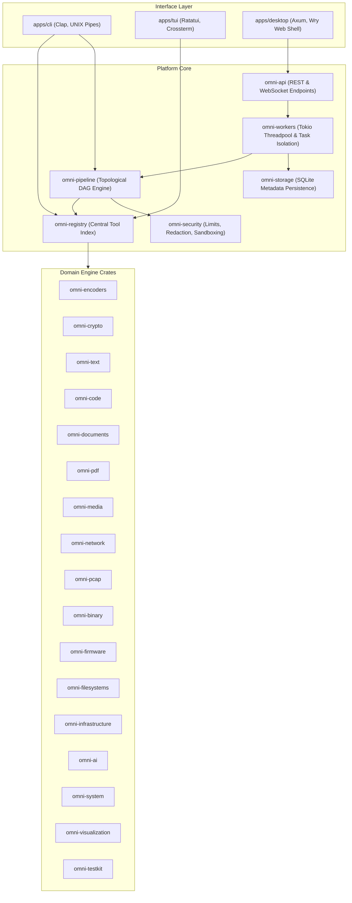

# OMNI Architecture Deep Dive

This document provides a technical walkthrough of OMNI's internal subsystems, memory model, concurrency isolation, and zero-trust security guarantees.

---

## 1. System Architecture

OMNI is structured as a decoupled workspace composed of 27 specialized crates:



---

## 2. Core Processing Model: DataPayload

All operations communicate via a strictly typed, zero-copy-friendly payload enum:

```rust
pub enum DataPayload {
    Text(String),
    Bytes(Vec<u8>),
    Json(serde_json::Value),
    FileRef(PathBuf),
}
```

Key guarantees:
- **Type Safety**: Automatic runtime verification prevents incompatible pipes (e.g. piping non-UTF8 binary directly into a text formatter).
- **Streaming & File Offloading**: Large buffers exceeding the in-memory threshold (default 64 MB) are spilled safely to temporary disk files managed by `omni-storage` and cleaned up atomically upon drop.

---

## 3. Worker Isolation and Resource Limits

CPU-intensive and memory-heavy operations are isolated from the main UI thread via `omni-workers`:
- **Job Cancellation**: Coordinated via atomic flags (`AtomicBool`) and channel notification.
- **Timeouts**: Every background job enforces configurable timeouts via `tokio::time::timeout`.
- **Decompression Bomb Protection**: Enforced globally by `omni_security::ResourceLimits::check_decompression`, capping uncompressed stream ratios at 100:1 and maximum uncompressed size at 500 MB.
- **Redaction**: All logs, execution traces, and error outputs pass through regex sanitizers to mask API tokens, private keys, and authorization headers.

---

## 4. Persistence Architecture

Persistent application state, job execution history, reusable pipeline graphs, and user preferences are maintained locally in an embedded SQLite database (`omni.db`).
- **WAL Mode**: Write-Ahead Logging enables high-concurrency read/write operations without blocking UI queries.
- **Zero Telemetry**: No network calls, telemetry beacons, or external reporting mechanisms exist in the codebase.
